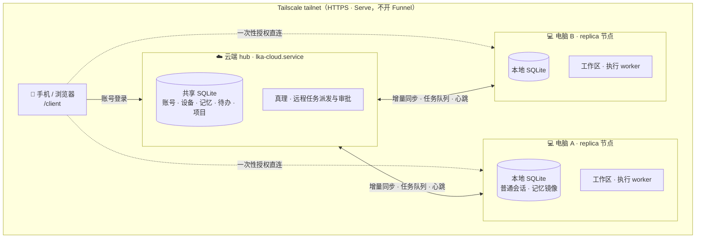

<div align="center">


<h1>LKA · Local Knowledge Agent OS</h1>

<p>
一个在本机运行的个人助手后端。<br>
处理邮件与消息、检索资料和网页、协助项目与代码任务，并保存对话、记忆和定时跟进。
</p>

<p>


</p>

<p>
<a href="#overview">概览</a> ·
<a href="#features">功能</a> ·
<a href="#deployment">部署结构</a> ·
<a href="#design">设计</a> ·
<a href="#quickstart">快速开始</a> ·
<a href="#evaluation">测试与评测</a> ·
<a href="#docs">文档</a>
</p>

</div>

---

<a id="overview"></a>

## 概览

LKA 把一次用户请求当作一个通用的 Agent 任务：模型决定查什么、调用哪个工具，
工具经过校验和安全审查后执行，结果和过程写入本地运行记录。邮件、消息、网页、
文件、记忆、待办等能力都以工具包的形式注册，核心不针对具体业务写死流程。

本仓库是后端，提供 HTTP / SSE 接口、命令行客户端和一个内置的浏览器页面 `/client`。
桌宠与完整工作台在独立仓库 [LKA Desktop](https://github.com/Viottery/lka-desktop)。

默认在单台电脑上独立运行。需要时也可以部署一台自己的云服务器，连接多台电脑和手机，
见[部署结构](#deployment)。

<a id="features"></a>

## 功能

| 领域 | 内容 |
| :--- | :--- |
| 📬 邮件与消息 | 搜索、批量阅读、按发件人与事项归类；消息历史检索、话题与人物整理、查看原消息上下文。以读取和整理为主，不自动发信或回复 |
| 📚 知识检索 | 文档、邮件、消息与工作区的关键词检索，可选本地向量召回与重排序；回答可追溯到原文 |
| 🌐 网页研究 | 网页与新闻搜索（Brave Search API），打开正文、定位段落、续读快照或刷新，保留来源与抓取时间 |
| 🛠️ 项目与代码 | 项目下多会话，读写文件、执行命令与测试；复杂任务可选多 Agent 并行，子任务独立上下文与预算 |
| 🧠 长期记忆 | 从对话中提取偏好、约定与事实，分全局和项目两级；可更新、撤回，保留来源，后台整理摘要 |
| 🧭 定时关注 | 设定目标、来源和检查时间；每次投递生成新会话，可在简报里继续追问 |
| 🗂️ 待办与规划 | 计划日期、时段和截止时间，规划分阶段；删除可撤销，来自消息的事项需单独审批 |
| 🧑‍💼 真理（长期助理） | 一个持续存在的管理会话：记录目标、按时跟进，把具体工作派给独立任务或远程设备，结果带主题送回。需开启 `management.enabled` |

几个日常例子：

```text
这周的邮件里，哪些事情需要我回复？按事项整理，附上对应邮件。
最近这个群在讨论什么？让我能查看原消息。
结合项目文档和代码，解释这个错误的原因，先分析再给修改建议。
在书桌电脑的项目工作区里检查测试结果，需要修改时先让我确认。
```

<a id="deployment"></a>

## 部署结构

LKA 支持两种形态，后者完全可选。

**单机。** 一个后端进程，默认监听 `127.0.0.1:8765`，数据保存在本机 SQLite（默认 `data/runtime`）。
桌面前端、命令行和 `/client` 都连接这个进程。

**云端 + 多节点。** 一台 Ubuntu 22.04 云服务器作为 hub，每台电脑作为 replica 节点，网络由 Tailscale 提供。



| 部分 | 运行方式 | 保存什么 |
| :--- | :--- | :--- |
| 云端 hub | 专用用户 `lka`，源码 `/opt/lka-backend`，配置 `/etc/lka`，数据 `/var/lib/lka`；systemd `lka-cloud.service`，`--require-auth`，单进程监听 127.0.0.1，经 `tailscale serve` 提供 HTTPS | 账号、设备登记与授权、共享记忆、待办、项目、真理会话、远程任务记录 |
| 电脑节点 | Linux 用 `lka-node.service`（`--require-node`），Windows 用 `start_backend.py personal --require-node`；设备 token 放在 `LKA_NODE_TOKEN` | 普通会话、工作区文件、本机模型配置、共享记忆的本地镜像 |
| 浏览器 / 手机 | 打开云端或节点的 HTTPS `/client`，无需安装 | 只持有 HttpOnly cookie |

几条边界：

- 每个节点有独立 SQLite，不共享数据库文件，普通会话不复制到其他机器。
- 手机切换到某台电脑时，云端签发一次性授权（放在 URL fragment，读取后清除），节点换成自己的连接 cookie（默认 30 天）。之后的请求直接到节点。
- 云端暂时离线时，已连接节点的普通会话、文件操作和记忆缓存照常使用；新的登录、授权和远程派发等待云端恢复。
- 远程任务只由指定节点领取，支持取消、检查点暂停恢复和同会话续作；指定节点不可用时直接报错。
- 账号、设备权限（heartbeat、sync.read、sync.memory.* 等 scope）与 Tailscale 准入分别配置。原生 shell 默认关闭。
- 云端、多设备、远程执行与记忆同步默认全部关闭，需要显式启用。

当前状态：后端能力已通过合成数据与模拟模型的集成测试（含双节点）。实机多设备的长期运行仍在验收中；
自动工作区挂载、跨设备累计预算和完整安装更新器尚未提供。部署步骤见
[维护说明 · Ubuntu 云端](docs/maintenance.md#ubuntu-2204-云端共享核心)，客户端接入见
[接口交付文档](docs/distributed_client_handoff.md)。

<a id="design"></a>

## 设计

```text
请求 → Agent Loop ─┬─ 展开工具包 → Tool Executor（schema 校验）→ 安全审查 → 执行
                   ├─ 多 Agent 计划 → 子任务（独立上下文 / 工具范围 / 预算）
                   └─ 最终回答
          │
          └─ 运行记录 / trace / 审计（本地）     后台：记忆提取、摘要、定时关注、同步
```

| 问题 | 做法 |
| :--- | :--- |
| 工具和资料多，上下文有限 | 工具按包发现、按需展开；长结果保存原文，先给预览并保留续读句柄 |
| 并行任务需要可控 | 计划表达依赖关系，子 Agent 不继承父会话完整历史，失败反馈给父任务修订 |
| 后台整理不能拖慢对话 | 记忆和摘要在后台执行，持久作业使用租约、检查点和发布前版本校验 |
| 写操作需要把关 | 每个工具声明 `read_only`；非只读工具必经审查（skip / llm / manual 模式，都会留下记录） |
| 凭据不给 Agent | 命令不继承模型密钥与控制令牌；读取 `.env`、私有配置或环境变量始终需要确认 |
| 跨机器协作和断网 | 云端只协调，节点保留本地状态；持久队列与增量同步，重连后补齐 |

目录约定：

| 目录 | 职责 |
| :--- | :--- |
| `app/core/` | Agent 核心：LLM、会话与上下文、运行与 trace、安全审查 |
| `app/domains/` | 确定性的领域服务，不调用 LLM |
| `app/tool_packages/` | Agent 可见的工具包实现 |
| `app/integrations/` | 第三方服务接入 |
| `app/platform/` | 操作系统与路径适配 |
| `app/experts/` | 领域专家策略 |
| `app/storage/` | 本地持久化基础设施 |
| `tests/` · `evals/` · `scripts/` | 回归测试、评测资产、运维脚本 |

模型和客户端不写死在业务代码中，选择顺序为请求覆盖 → 会话偏好 → 配置默认。
流式与非流式回复共用同一套 LLM 服务，provider 错误分类记录。

<a id="quickstart"></a>

## 快速开始

需要 Python 3.12+，原生运行，不使用 Docker。

<details open>
<summary><strong>🐧 Linux</strong></summary>

```bash
uv sync --locked
test -f .env || cp .env.example .env
test -f config/local.toml || cp config/local.example.toml config/local.toml
# 编辑 config/local.toml 与 .env，填写模型连接
uv run python scripts/start_backend.py personal
```

另开终端：

```bash
curl -sS http://127.0.0.1:8765/health
uv run lka chat --session-id my-assistant
```

</details>

<details>
<summary><strong>🪟 Windows</strong></summary>

```powershell
powershell -NoProfile -ExecutionPolicy Bypass -File .\scripts\setup_windows.ps1
.\.venv\Scripts\python.exe scripts\start_backend.py personal
```

安装脚本只在缺失时创建 `.env` 与 `config/local.toml`，不覆盖已有配置。

</details>

配置模板默认使用 mock 模型。接入真实模型后，再按需启用邮箱、搜索、消息来源、
多 Agent 和邮件专家。健康检查应返回 `status: ok` 与 `service: local-knowledge-agent-os`。

文件与命令工具的范围由 `LKA_WORKSPACE_ROOTS` 限定（留空表示不限制）。
凭据保护按路径和命令识别，不是操作系统级沙箱。

<a id="evaluation"></a>

## 测试与评测

```bash
uv sync --locked --extra dev
.venv/bin/python -m pytest -q
```

测试只收集 `tests/`。评测按用途分开，不合并成一个通过率：

| 类别 | 关注点 | 入口 |
| :--- | :--- | :--- |
| 目标驱动任务 | 文件是否整理好、测试是否通过、是否漏掉发件人 | [scripts/eval_realworld.py](scripts/eval_realworld.py) |
| 长期运行 | 中断恢复、幂等、记忆来源与项目归属 | [崩溃恢复测试](tests/test_background_crash_recovery.py) · [记忆评测](scripts/eval_memory_release.py) |
| 多节点 | 指定节点领取、直连隔离、断云继续、记忆同步不重复 | [双节点集成](tests/test_distributed_two_nodes.py) · [记忆复制](tests/test_memory_replication_runtime.py) |
| 网页与缓存 | 预览能否还原全文、快照复用、旧缓存不被当作最新 | [网页快照](tests/test_web_snapshots.py) · [缓存场景](tests/test_observation_cache_scenarios.py) |
| 检索问答 | Recall@k、MRR、nDCG、多跳证据覆盖、p50/p95 延迟 | [公开数据集](evals/datasets/public_multihop/manifest.json)（HotpotQA、2WikiMultiHopQA、MuSiQue、MultiHop-RAG） |

历史问题整理在[质量案例目录](evals/fixtures/linux_quality_cases_2026-10-05.json)，可以只生成选例计划而不调用模型：

```bash
uv run python scripts/eval_quality_catalog.py --profile all --inventory --json
```

模拟模型下的通过不代表真实模型的任务质量；真实模型评测需单独授权并限定预算，详见 [evals/README.md](evals/README.md)。

## 数据与隐私

会话、知识、记忆和运行记录保存在本机。使用远程模型时，对话与选中的资料片段会发送给所配置的模型服务；
网页搜索会把查询发给搜索服务。运行日志可能包含提示词和邮件正文，请留在本地。
`.env`、`config/` 下的真实配置和数据目录不进入 Git，仓库只保留无凭据模板。

<a id="docs"></a>

## 文档

| 主题 | 文档 |
| :--- | :--- |
| 安装、更新与备份 | [getting_started](docs/getting_started.md) · [maintenance](docs/maintenance.md) |
| 配置 | [configuration](docs/configuration.md) · [local.example.toml](config/local.example.toml) |
| 日常使用 | [usage](docs/usage.md) |
| 系统架构 | [architecture](docs/architecture.md) |
| 接口 | [api_contract](docs/api_contract.md) · [distributed_client_handoff](docs/distributed_client_handoff.md) |
| 评测 | [evals/README](evals/README.md) |
| 全部 | [docs/README](docs/README.md) |

---

<div align="center">
<sub>LKA Backend · 前端见 <a href="https://github.com/Viottery/lka-desktop">LKA Desktop</a></sub>
</div>
