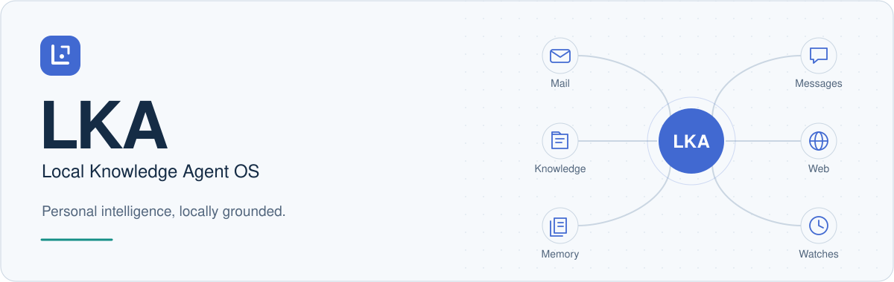
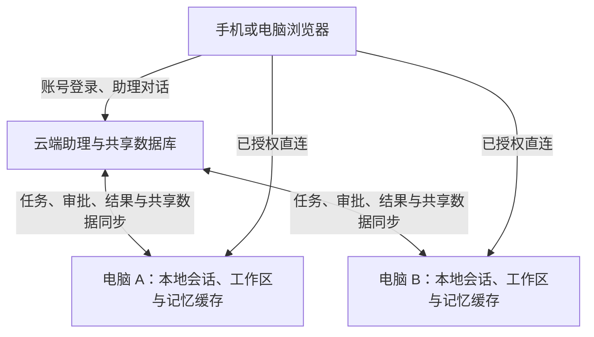

<div align="center">



<h1>查资料、处理任务，记住你交代过的事。</h1>

<p>
一个能查邮件、读消息、整理资料，也能帮你处理项目任务的个人 AI 助手。<br>
保存对话和记忆，需要时继续跟进之前的事。<br>
可以独立运行在本机，也可以用云端助理连接多台电脑，从手机继续工作。
</p>

<p>


</p>

<p>
<a href="#capabilities">功能介绍</a> &nbsp; / &nbsp;
<a href="#multi-device">多终端协作</a> &nbsp; / &nbsp;
<a href="#everyday">日常场景</a> &nbsp; / &nbsp;
<a href="#engineering">设计思路</a> &nbsp; / &nbsp;
<a href="#evaluation">评测实践</a> &nbsp; / &nbsp;
<a href="#roadmap">未来方向</a> &nbsp; / &nbsp;
<a href="#getting-started">开始使用</a> &nbsp; / &nbsp;
<a href="#documentation">阅读文档</a>
</p>

</div>

---

## 邮件、消息和项目里的事，都可以交给它处理

重要信息往往分散在不同地方：邮件里的约定、群聊里的变化、项目里的文档，
还有你在之前对话里提过的偏好。

**LKA 可以结合这些信息处理任务。** 你说明要做什么，助手查找资料、调用工具，
整理结果。对话和记忆会保存下来，需要持续跟进的事可以设为后台任务。

本仓库提供 LKA 的后端，负责对话、工具执行、知识检索、记忆和持续关注，
并内置适合手机和电脑浏览器的 `/client` 页面。桌宠与完整工作台由独立的
[LKA Desktop](https://github.com/Viottery/lka-desktop) 提供。

<a id="capabilities"></a>

## ✦ 可以用它做什么

<table>
<tr>
<td width="50%" valign="top">

<h3>📬 邮件与消息</h3>
<p>查找邮件和聊天记录，整理需要跟进的事。</p>
<p>搜索邮件、批量阅读、按发件人归类，并关联已有事项。
接入消息历史后，可以检索原始对话、整理话题和重要信息，
查看人物档案及相邻消息。</p>

</td>
<td width="50%" valign="top">

<h3>📚 私人知识库</h3>
<p>从自己的资料里查答案。</p>
<p>连接文档、邮件、消息与工作区，按问题检索相关内容。
关键词搜索、可选的本地语义召回和重排序共同提供上下文，
让你能够继续追问出处、细节与原文。</p>

</td>
</tr>
<tr>
<td width="50%" valign="top">

<h3>🌐 网络研究</h3>
<p>搜索网页，找到相关内容后继续读原文。</p>
<p>搜索网页与新闻，获取关键摘录，再按需打开正文、定位段落、
续读已有快照或刷新内容。保留来源和抓取时间，
方便在后续对话中继续研究。</p>

</td>
<td width="50%" valign="top">

<h3>🛠️ 项目协作</h3>
<p>查项目资料、分析代码，也可以修改文件和运行测试。</p>
<p>在一个项目下开展多个会话，读取资料、分析代码、编辑文件、
执行命令与测试。复杂任务可开启多 Agent 协作，
让子 Agent 并行处理独立子问题，再汇总结果。</p>

</td>
</tr>
<tr>
<td width="50%" valign="top">

<h3>🧠 长期记忆</h3>
<p>记住你提过的偏好和约定。</p>
<p>整理对话中有价值的偏好、约定和事实，分别保存到全局或项目记忆。
记忆可更新、撤回，并保留来源。
后台整理记忆和对话摘要，供后续会话使用。
启用云端同步后，多台电脑可共享记忆，并从本地缓存读取。</p>

</td>
<td width="50%" valign="top">

<h3>🧭 持续关注</h3>
<p>按设定的时间检查，整理变化并给出简报。</p>
<p>设定关注目标、信息来源和每日检查时间，跟进新闻、活动、
邮件与本地事项。每次检查投递简报时创建新会话，
你可以直接在这份简报里继续追问。</p>

</td>
</tr>
<tr>
<td width="50%" valign="top">

<h3>🗂️ 待办与规划</h3>
<p>记下要做的事，排进日历，拆成规划和阶段。</p>
<p>任务支持计划日期、具体时段和截止日期；规划下可以分阶段组织任务并查看进度。
删除的事项可以撤销恢复。Agent 通过事项工具读写，来自消息的事项需要单独审批。</p>

</td>
<td width="50%" valign="top">

<h3>🧑‍💼 真理 · 持续管理</h3>
<p>一个长期存在的助理会话，替你盯着目标。</p>
<p>记录你交代的目标，按时间再次跟进；把具体工作派给独立任务执行，
完成后把结果送回对话，每次交付带上主题。
启用远程执行后，可把工作派到已授权的电脑与工作区。需要开启 <code>management.enabled</code>。</p>

</td>
</tr>
</table>

<a id="multi-device"></a>

## ☁️ 一个助理，连接多台电脑

你可以把助理和共享数据库部署到自己的云服务器，让电脑分别保留本地数据库、
工作区和普通会话。手机打开浏览器即可与云端助理对话，也能选择连接某台电脑，
直接处理那台电脑上的会话和文件。云端协作为可选部署方式，默认仍可独立在本机使用。



| 你想做的事 | 当前支持的方式 |
| :--- | :--- |
| 从手机切换电脑 | 云端登录后选择设备，建立独立的节点连接；普通会话和工作区文件直接访问目标电脑 |
| 把任务交给合适的设备 | 指定设备、系统环境或工作区，也可允许助理在已授权的在线节点中选择；指定目标不可用时明确报错 |
| 跟进远程任务 | 助理会话、任务审批与结果经云端中转，支持取消、检查点暂停与恢复，以及在原任务会话继续补充要求 |
| 在多台电脑使用同一份记忆 | 后台同步到本地镜像；自动学习记忆沿用原生效状态、精确去重并保留来源，已识别冲突留待核对；撤回和来源失效随同步传播 |
| 云服务器暂时离线 | 已连接电脑的普通会话、文件操作和记忆缓存仍可使用，需要该电脑自己的可用模型配置；新的云端登录、连接授权和助理任务派发等待云端恢复 |

应用账号、设备权限与 Tailscale 网络准入分别配置。账号面向同一套个人数据的受信任管理者；
电脑数据库各自独立，同步共享信息，普通会话保留在各自节点，不共享 SQLite 文件。
云端、多设备连接、远程执行和自动记忆同步默认关闭，按需要显式启用。

> [!IMPORTANT]
> 后端已包含上述能力及浏览器入口，并完成合成数据与模拟模型下的回归验证。
> 真实服务器、Tailscale 与多台实际设备仍需部署验收。旧桌宠工作台的多机界面适配仍待完成，
> 接入方式见[接口交付文档](docs/distributed_client_handoff.md)。自动工作区挂载、跨设备累计预算和完整安装更新器仍在计划中。

部署请从 [Ubuntu 22.04 云端与节点维护说明](docs/maintenance.md#ubuntu-2204-云端共享核心)
及 [账号、同步和设备连接配置](docs/configuration.md#可选云端账号设备与共享同步)开始。

<a id="everyday"></a>

## 💬 日常可以这样用

### 看看哪些邮件需要回复

> 这周的邮件里，哪些事情需要我回复？按事项整理，附上对应邮件。

接入邮箱后，助手可以从邮件中查找依据，整理相关往来，
结合已有事项帮助你判断下一步。

### 了解群里最近在聊什么

> 最近这个群在讨论什么？有哪些值得关注的变化？让我能查看原消息。

看完总结后，可以继续查看具体话题、
相关人物、原始消息和上下文。

### 结合项目资料排查问题

> 结合项目文档和代码，解释这个错误的原因。先分析，再给出修改建议。

围绕同一个项目保持多个会话，使用工作区指导、项目记忆和实际文件，
继续调研、排查或修改代码。

### 在手机上继续电脑里的工作

> 在书桌电脑的项目工作区里检查测试结果，需要修改时先让我确认。

手机与云端助理对话，由助理把任务派给已授权的目标设备。
需要自己继续查看文件或开展普通会话时，也可以直接切换到那台电脑的 `/client` 页面。

### 定时检查关注的事

> 每天看看我关注的活动，有值得关注的变化时整理一份简报，方便我继续追问。

将关注目标保存为定时任务；后端运行期间，按设定时间执行检查，
把本次结果放进新的会话。

## ◇ 数据、模型和操作怎么管理

**数据主要保存在本地。** 会话、知识、记忆与运行记录由本机保存，
默认服务只监听本机地址。启用云端协作后，共享数据由自己的云服务器管理，
电脑保留本地数据库和记忆镜像，普通工作直接读取本地缓存。

**模型服务可以自己配置。** 连接模型和自己的数据源，按需启用邮件专家、
多 Agent、消息分析与后台任务。

**工具操作按配置审查。** 工具调用会经过安全审查，也可以配置为人工确认。
相关调用、来源和运行过程保留记录，方便回看。

**密钥不交给 Agent。** Agent 运行的命令不会继承模型 API Key、控制令牌等凭据；
读取 `.env`、私有配置、密钥文件或列出环境变量时，无论审查模式如何都需要你确认。

**工作区按需创建。** 新会话只预留默认工作区的路径，第一次把文件写进去时才创建并登记为项目。
只是聊天，或只修改其他目录里的已有文件，不会留下空文件夹。

**运行记录会自动瘦身。** 任务结束后只保留最后一份运行快照；
旧数据库可以用 `scripts/prune_graph_runtime_artifacts.py` 预览并清理。

**长内容可以分次读取。** 工具返回的长结果保留在本地，先提供预览，
需要时再读取更多，减少重复获取同一份资料。

<details>
<summary><strong>🔎 关于数据连接</strong></summary>

使用远程模型时，发送给模型的对话、选取的资料片段和后台整理输入，
会交给你配置的模型服务；网页搜索会把查询发送给搜索服务。

完整运行日志可能包含个人内容，请妥善保管。
真实配置、密钥、邮箱授权和运行数据保持本地，仓库只保留无凭据的配置模板。

</details>

<a id="engineering"></a>

## 🧩 后端怎么工作

后端负责把对话、资料和工具组织到一次任务里，也负责保存结果和处理后台作业。
下面是几个主要的设计选择：

| 面对的问题 | 设计选择 | 解决什么问题 |
| :--- | :--- | :--- |
| 工具和资料越来越多，上下文却有限 | 工具按包发现、按需展开；长结果保存原文，先送预览，再按需续读 | 减少无关输入，需要更多内容时仍能读取原文 |
| 复杂任务需要并行，但不能失去控制 | 任务计划表达依赖关系；子 Agent 使用独立上下文、工具范围和预算，失败反馈给父任务修订计划 | 记录分工和交付结果，失败时由父任务调整计划 |
| 助手需要长期整理信息，又不能拖慢对话 | 记忆提取和摘要放到后台；持久作业配合租约、检查点及发布前版本校验 | 减少对话等待，支持中断后继续处理，避免旧任务覆盖新结果 |
| 助理和执行设备分处不同机器，网络也可能中断 | 云端协调任务，各电脑保留本地会话与数据库；持久队列、增量同步及记忆镜像处理跨机协作 | 已连接节点可继续普通工作，重新连云后恢复同步，远程任务保持原设备与工作区约束 |
| 不同任务、模型和平台需要持续扩展 | 通用 Agent 核心与领域服务分离；工具输入校验、操作审查和运行记录统一处理 | 邮件、网页、文件等功能可以分别修改，Windows / Linux 共用主要运行逻辑 |

这些机制已经有对应实现。可以从 [系统说明](docs/architecture.md) 了解全貌，
也可以直接阅读 [多 Agent 调度](app/core/multi_agent_scheduler.py)、
[工具结果处理](app/core/tool_result_gate.py) 和 [后台作业](app/core/background_jobs.py)。

<a id="evaluation"></a>

## 🧪 怎么测试和评估

一次工具调用成功，不等于任务完成。LKA 将接口回归、目标驱动任务和公开检索评测分开，
同时观察结果、来源、实际操作、耗时与模型消耗。

<div align="center">

<table>
<tr>
<td align="center"><h3>17</h3><sub>套评测定义</sub></td>
<td align="center"><h3>56</h3><sub>个套件案例</sub></td>
<td align="center"><h3>29</h3><sub>个目标驱动场景</sub></td>
<td align="center"><h3>1,128</h3><sub>条公开多跳查询</sub></td>
</tr>
</table>
<sub>仓库评测资产统计 · 2026-10-06 · 各类资产分别计数，不合并为通过率</sub>

</div>

| 评测视角 | 关注什么 | 可查看的内容 |
| :--- | :--- | :--- |
| 日常任务 | 文件是否真正整理好、代码是否通过原有测试、邮件是否漏掉发件人；不在用户任务中指定工具路线 | [目标驱动场景与执行器](scripts/eval_realworld.py) |
| 长期运行 | 进程中断后能否恢复、重复执行是否产生重复记录、摘要与记忆是否保持正确来源和项目归属 | [真实进程退出测试](tests/test_background_crash_recovery.py) · [记忆回归评测](scripts/eval_memory_release.py) |
| 多终端协作 | 任务是否只由指定节点领取、直连是否隔离助理会话、断云后普通工作是否继续、记忆同步后是否重复或复活 | [云端与双节点集成](tests/test_distributed_two_nodes.py) · [记忆复制与离线缓存](tests/test_memory_replication_runtime.py) |
| 信息获取 | 搜索预览能否恢复完整内容、后续阅读是否复用快照、旧缓存是否被误当成最新信息 | [网页快照测试](tests/test_web_snapshots.py) · [缓存场景测试](tests/test_observation_cache_scenarios.py) |
| 检索与问答 | 相关文档与多跳证据是否召回，排序质量、最终答案与检索延迟分别如何 | [公开数据清单](evals/datasets/public_multihop/manifest.json) · [评测方法](evals/README.md) |

公开检索样本来自 **HotpotQA、2WikiMultiHopQA、MuSiQue 和 MultiHop-RAG**。
检索侧记录 Recall@k、MRR、nDCG、多跳证据覆盖和 p50 / p95 延迟；
问答侧另行检查答案与引用，不把“搜到了文档”当成“回答正确”。
任务回放还记录模型调用次数、Token 用量、工具轨迹和文件变化，便于分析质量与开销的取舍。
多终端集成测试使用独立临时数据库和模拟模型；浏览器回归使用合成响应，
这些结果不替代真实设备网络、长期运行或真实模型任务质量验收。

<details>
<summary><strong>🔬 失败案例与回归检查</strong></summary>

历史质量迭代整理了 [43 个案例、9 个能力分组](evals/fixtures/linux_quality_cases_2026-10-05.json)，
每个条目记录现象、原因、改进方法、验收要求和回归入口。
基础检查、已修复回归与困难案例可分别选择，避免每次都重复跑低信息量测试。

例如，长内容阅读要检查是否能回到原文；网页刷新要区分新结果与旧快照；
多 Agent 任务要检查各项子任务是否交付，而不只检查最终答案里有没有关键词。

截至 **2026-10-05 的历史目录**，17 个条目有修复后的现场验证，14 个只完成离线回归，
8 个仍标记为待解决，另有 4 个基线通过条目。它们不是当前版本的总体准确率，
离线通过也不代表真实模型任务已完成；复杂任务交付、网页证据表达与多跳问答仍需继续验证。

可以先生成选例和回放计划，不调用模型、不读取私人邮件：

```bash
uv run python scripts/eval_quality_catalog.py --profile all --inventory --json
uv run python scripts/eval_quality_catalog.py --group multi_agent --group web
```

完整运行方式、指标口径与真实模型测试的启用条件见 [评测指南](evals/README.md)。
私人邮件、个人消息和完整运行日志不随仓库发布。

</details>

<a id="roadmap"></a>

## 🗺️ 接下来改进什么

通用 Agent、工具与检索、多 Agent、记忆、后台作业、定时关注、待办、真理及可选多终端后端已有主要实现。
下一阶段优先验证实际部署和日常可靠性，再完善客户端体验。下面列的是计划，尚未全部完成。

| 阶段 | 重点方向 | 如何判断进步 |
| :--- | :--- | :--- |
| **近期 · 部署与稳定** | 完成云端、两台电脑和手机的实机验收，检查 HTTPS、权限撤销、断网恢复与长期运行；持续完善回归、CI 和备份保留策略 | 实际设备能完成派发、直连与同步；异常恢复行为明确；数据库与备份体积长期稳定 |
| **近期 · 任务完成与响应速度** | 补齐复杂任务的遗漏、部分成功与失败恢复；优化首轮响应、缓存续读和结果交付 | 在固定困难案例中检查任务完成情况，对比首答时间、总耗时、重复调用与 Token 消耗 |
| **中期 · 主动助理** | 把目标、交付、待办和待确认操作合成一个“今天”视图；交付附结果摘要，同主题归为一条线；改进记忆纠正与简报去重 | 每天打开一处就知道要决定什么、已办完什么；已撤回的信息不再出现，简报不重复 |
| **中期 · 成本与过程可见** | 按目标和会话展示 Token、耗时与失败原因；活动记录可追溯到原始运行 | 能回答“这个跟进每天花多少、值不值”，每次读写都能找到来源 |
| **长期 · 数据源与客户端接入** | 将验证过的工作流沉淀为可复用技能，探索 MCP 与更多数据源接入；完善桌宠多机接入、安装更新、工作区挂载和跨设备累计预算 | 新能力可独立接入并复验，新电脑能按向导接入；跨机操作保持来源、权限与预算约束 |

多跳检索、查询改写与本地重排序作为持续研究方向，
用相同数据与配置比较证据覆盖、答案质量和延迟，检查它们对实际任务的帮助。

<a id="getting-started"></a>

## 🚀 开始使用

需要 **Python 3.12+**。Windows 使用 PowerShell，Linux 另需安装 `uv`；
两者都以原生 Python 运行，无需 Docker。

安装后先配置模型，再按需要接入邮箱、搜索或消息来源。

<details open>
<summary><strong>🪟 Windows</strong></summary>

在克隆后的仓库目录中安装：

```powershell
powershell -NoProfile -ExecutionPolicy Bypass -File .\scripts\setup_windows.ps1
```

脚本准备依赖，仅在缺失时创建 `.env` 和 `config/local.toml`，保留已有配置。
填写本地模型连接与密钥后，启动：

```powershell
.\.venv\Scripts\python.exe scripts\start_backend.py personal
```

</details>

<details>
<summary><strong>🐧 Linux</strong></summary>

在仓库目录中准备依赖和配置：

```bash
uv sync --locked
test -f .env || cp .env.example .env
test -f config/local.toml || cp config/local.example.toml config/local.toml
```

填写本地模型配置后，启动：

```bash
uv run python scripts/start_backend.py personal
```

在另一终端使用命令行客户端：

```bash
uv run lka chat --session-id my-assistant
```

</details>

> [!NOTE]
> **首次配置**<br>
> 模板使用 mock 模型；接入真实模型后，再按需配置邮箱、搜索和消息来源。
> 多 Agent 与邮件专家需单独开启。当前搜索使用 Brave Search API，
> QQ 消息依赖独立采集器。

默认服务地址：`http://127.0.0.1:8765`，启动后可访问 `/health` 检查状态。

开发时先 `uv sync --locked --extra dev`，再运行 `.venv/bin/python -m pytest -q`。
测试只收集 `tests/` 目录，不会进入 `data/` 下的基准仓库。

云端或电脑节点按 [多终端配置](docs/configuration.md#设备直连与远程任务)启用后，
可从其 HTTPS 入口打开 `/client`，使用内置的会话、设备连接、工作区文件和共享记忆界面。
云端还提供统一助理与远程任务查看、审批入口。
Ubuntu 22.04 需要另行准备 Python 3.12+，云端部署步骤见
[云端共享核心](docs/maintenance.md#ubuntu-2204-云端共享核心)。

想使用桌宠与完整工作台，请另外准备 [LKA Desktop](https://github.com/Viottery/lka-desktop)。
Windows 的完整操作与另一台电脑的更新步骤，分别见
[安装指南](docs/getting_started.md) 和 [更新与维护](docs/maintenance.md)。

<details>
<summary><strong>☕ 使用小贴士</strong></summary>

- 邮件和消息功能以读取、分析与整理为主，当前不提供自动发信或消息回复。
- 网页工具读取公开网页文本；需要登录或依赖 JavaScript 的页面，建议在浏览器中查看。
- 大批量分析在后台分批进行，达到配额时等待后续执行；可以查看处理进度。
- 定时关注需要后端持续运行。会话简报已有后端支持，桌面推送需前端配套。
- 文件与命令工具在实际执行任务的设备上运行。启用前请设置 `LKA_WORKSPACE_ROOTS`（留空表示不限制目录）和确认方式；
  凭据保护按路径和命令识别，不是操作系统级隔离环境。
- 重要日期、金额和票务状态，建议沿着来源再核对一次。
- 多终端共享同步需显式配置和授权；当前不复制普通会话、模型密钥或工作区文件，不提供自动安装更新。
- 已有私人便携包含账号凭据，仅适合私下迁移，不作为公开发行包。

</details>

<a id="documentation"></a>

## 📖 文档入口

| 想了解什么 | 从这里开始 |
| :--- | :--- |
| 安装、运行与迁移 | [安装指南](docs/getting_started.md) · [更新与维护](docs/maintenance.md) |
| 模型与功能配置 | [配置说明](docs/configuration.md) · [本地配置模板](config/local.example.toml) |
| 云端、电脑节点与手机接入 | [云端部署](docs/maintenance.md#ubuntu-2204-云端共享核心) · [账号与同步配置](docs/configuration.md#可选云端账号设备与共享同步) |
| 会话、记忆与持续关注 | [日常使用](docs/usage.md) |
| 系统如何工作 | [系统说明](docs/architecture.md) |
| 评测集、指标与复验 | [评测指南](evals/README.md) · [历史质量案例](evals/fixtures/linux_quality_cases_2026-10-05.json) |
| 接入自己的界面 | [API 文档](docs/api_contract.md) · [多终端客户端接口交付](docs/distributed_client_handoff.md) |
| 全部文档 | [文档导航](docs/README.md) |

---

<div align="center">

<strong>查资料、用工具、保存上下文，按需要继续跟进。</strong><br>
<sub>LKA · Local Knowledge Agent OS</sub>

</div>
