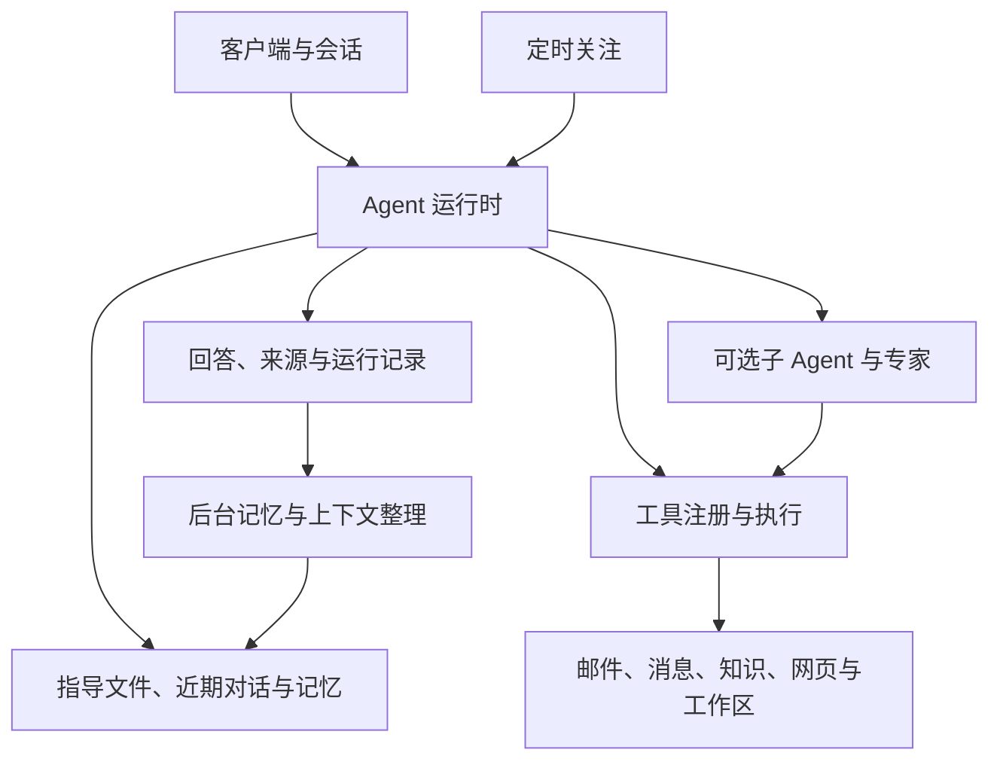
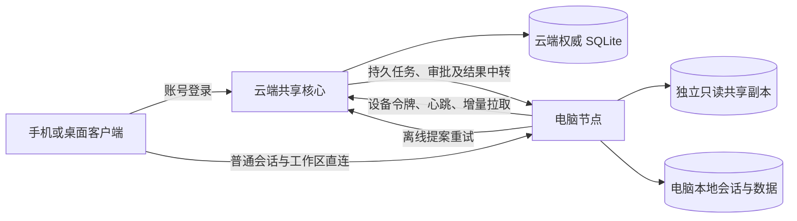

# 系统说明

本页说明当前后端组成及协作方式，不包含实施计划或测试过程记录。
具体请求、状态与控制接口以 [API 说明](api_contract.md) 为准。

## 各部分如何协作

客户端可以是命令行、独立桌面前端或自行接入的应用。
后端以 FastAPI 提供普通请求和 SSE 流，SQLite 保存会话、运行及各领域数据。
不同会话显式传递身份，没有隐式的全局“当前会话”。

事项的 visibility 与管理用途、责任方、日期相互独立。默认用户投影只显示 user，
完整授权同步保留 internal；管理扩展与执行关系由专用领域服务维护。
绑定目标引用 Matter 作为业务事实，自主提案在最终消息、事件水位和运行终态的同一事务内发布。

会话类型区分 ordinary 和可选的 manager。管理会话复用普通消息、运行、SSE 和检查点，
确定性管理服务保存 controller、默认入口、长期目标、事件收件箱与交付索引，不进行模型调用。
关注目标由主管在已接受的用户委托内按需组织，用于保留跨轮承诺、依赖与验收缺口，不限于用户指定的定时提醒；自然文字 objective 保存来源、剩余条件、证据、下一步与退出条件。目标可独立于 Matter，内部关注与用户通知策略分别处理。统一后台巡检时钟持久保存下一次到期和代次，到期为全部有效活跃目标捕获巡检事件，不依赖每个目标的定时器或任务等待；现有协调器按最多 16 个事件分批冻结目标版本并唤醒助理。未消费巡检合并等待，错过的周期不逐个补跑，重启不重置时钟、事件或用量。目标形成与语义验收仍由模型判断；任务续作、用户更正／撤回和业务验收需相应修订／取消／完成目标。
绑定运行时的规则投影按临期／逾期、优先级、所属任务状态和记录年龄排序，将有界的 attention_context 直接附入输入 envelope；同时支持已有授权 Matter 关注事件。从最多 16 个候选事件中按上下文容量接纳不超过 8 张关注卡片，总投影不超过 4500 字符，单项目标正文最多预载 1200 字符。未接纳的关注事件保留待处理，后续批次继续，不会随本轮消费。完整正文无需再调用目标读取，截断部分保留读取入口。投影只读取当前批次冻结版本，并复验 Matter 来源和任务归属；卡片是状态快照，不替代外部源的时效核验。统一巡检可在通知静音时内部发布，通知投影及最终提交共同执行交付约束。
主管可通过 delegate_work 创建独立 manager 类型的事务线子 agent，保存归属、目标、冻结工具清单、默认执行目录与来源 envelope。
子 agent 是独立持久会话，初始派发、任务返回和主管补充指令唤醒它的新一轮，不依赖主管旧 run 存活。
子 agent 可执行自己的工作，或创建与介入自己名下的多个 ordinary 执行会话；首版不递归创建下级主管。
结果先由所属子 agent 审阅，report_delegate 在最终发布同一事务提交，再进入主管 inbox 唤醒新轮并生成本地消息。
事务线已有执行任务时，各类报告须附带所属任务的结构化引用，提案与发布均复验归属；引用存在不等于业务结论正确。
失败、等待用户与未报告结果也保留稳定事件；执行终态不被推断为业务完成。

运行创建时冻结通用 session policy，统一控制模型默认值、工作区回退、工具和派发能力，
恢复和替换不会意外回到普通会话的完整能力。可选管理工具包创建独立 ordinary root，
命令指纹、会话关联、运行与派发 outbox 在 SQLite 同事务提交；重复命令读取原回执。
排队工作在受理时冻结独立 root、来源和额度，再由确定性就绪调度事务释放到通用 dispatcher；
期间不使用主管旧运行身份授权新建任务。工作区预留与公平水位持久保存，只读策略通过实际工具白名单限制。
显式 watch 订阅只消费现有已发布简报，按授权版本及稳定引用进入 inbox，不隐藏模型调用或扩大来源范围。
本地交付策略把捕获和提醒分开，静音／稍后保留未交付事件；发布同时复验交付策略与来源版本。
通用 session admission 为同一真实会话保留一个未终态主运行位置，child DAG 仍由原调度器处理。
默认全局助手的用户消息可先进入独立持久 FIFO 队列，按受理顺序预留普通用户轮；
首次派发执行前事务冻结兼容输入批次，多条真实消息可稳定关联同一运行。冻结后不再扩批，
原消息及来源独立保留，消息保存、主运行受理和派发使用事务去重。
当前轮结束后处理下一条，暂停／等待继续保留位置；显式新指令可通过原替换事务接替已暂停的根任务，消息、替代运行、队列观察位置与派发 outbox 一起提交，保留其余排队输入。用户轮失败或取消暂停队列，需用户显式继续；后台轮失败或策略取消不改变用户队列的暂停状态。
队列与后台事件收件箱分开，不修改后台事件身份、预算或交付条件，也不向当前运行注入消息。
通用输入 envelope 保存来源并以稳定消息 ID 去重，非用户输入不提取用户偏好。
通用 execution dispatcher 按租约动态启动独立执行线程，无固定管理 worker 池，执行已登记的 LangGraph 任务，续租并通过既有节点守卫阻止失租后的后续操作，
有检查点才恢复中断运行，不重建未知副作用任务。该切片支持单后端进程。
管理协调器捕获任务终态与到期 timer，以有界 ID 唤醒并冻结事件、目标版本和模型设置，
复用 dispatcher 执行原管理 run。controller 暂停时仍捕获事件。后台轮只附带当前事件因果关联的目标 ID 与版本，不预装全部活跃目标或目标正文；目标要求按需通过 read_goal 读取，无关目标不会参与该轮的目标版本 fence。
自主轮最终提交在同一 SQLite 事务核对租约、controller／目标版本与取消状态，
发布回答、上下文、目标提案、事件消费水位、run 终态及稳定本地 delivery 引用。
后台轮可用 `management.decide_notification` 单独决定是否向用户交付；不提醒仍原子保存内部回答、
上下文与进度，并消费对应事件。新后台轮未记录决定时默认静默，已有旧运行保留原交付行为；
普通用户问答不受这个决定控制。
业务提交后 checkpoint 尚未完成的恢复优先读取已提交 result artifact，避免重放工具。
独立任务继承持久额度和因果范围；自动设置的下一次 timer 也延续因果限制。
外部推送与用户输入自动抢占尚未实现。

## 可选云端共享核心与电脑副本

开启账号、设备和 hub 同步后，一个后端可作为个人云端核心：应用账号负责登录，
设备凭据负责节点访问，Tailscale 提供网络连通和访问边界；三者不互相代替。
账号都是同一套个人数据的受信任管理员。云端继续使用原有 SQLite、管理助理和单进程调度器，
共享数据的正式写入仍通过原领域服务完成。

领域表变更与同步引用日志在同一事务提交。拉取时按显式字段清单重新读取当前投影，
不把历史正文存进同步日志；来源失效、记忆过期、软删除等状态会抑制相关内容。
副本以固定 hub 身份、有序游标、实体版本和删除标记校验分页，保存在独立 SQLite 文件，
不会导入本地调度器的活动表。重复页和提案重试幂等；节点候选只进入待核对收件箱。
离线副本可能落后于云端，撤销授权不能远程擦除已经下载的数据。

设备登记保存批准的系统环境、工作区 ID、能力和同步 scopes。
账号可保存固定目标或限定候选范围的自动选择策略；固定目标不可用时明确报错。
可选远程执行把任务要求冻结为设备、系统、工作区 ID 和能力；不指定 execution_target 沿用云端本机，
传空对象表示在已授权在线节点中选择。指定设备/工作区不可用时不回退。
节点主动领取任务，经原 Agent dispatcher、工具执行器与人工审批执行；结果及审批通过云端中转。
远程执行会话不能通过设备直连读取或控制。租约/节点授权在步骤及结果提交点核验，未知结果不自动重放。

普通会话与映射工作区可由手机/电脑直接连接节点，使用节点本地持久认证会话，运行不依赖云端在线。
节点普通记忆上下文与读取工具使用本地镜像缓存，允许落后读取；项目关联须显式绑定，不能按同名路径猜测。
缓存不赋予执行权，也不复制调度所有权。远程委派采用有界输入快照，不自动读取节点私有记忆和指导文件。
共享副本包含记忆及助理业务状态的受限投影，不复制普通会话消息、在途执行或模型配置；
助理执行正文走专用任务回报中转，与缓存同步分开。检查点暂停、继续、问答与原会话补充指令
通过持久命令经云端中转，原设备与目录不可静默替换。正式共享记忆编辑使用独立离线队列、
人工确认与版本核对，冲突不覆盖云端现状，待提交内容不进入检索。
自动学习记忆采用独立的数据库变更日志/持久队列，受信任节点的专用发布 scope 允许沿用
既有 active/candidate 状态。云端事务内跨节点精确去重，保留独立来源及修订；候选不会因重复而生效，
矛盾记录待核对。镜像安装后持久接管本地同源条目，撤回后不退回旧本地 active。
本地连接的授权代次在重新连云后单调更新；密码变更或云端撤销不会把断网解释为退出登录。
Linux 支持操作者预先建立的原生挂载身份核验与直连文件访问；自动挂载、Windows 挂载核验、
通用工具对挂载工作区写入、跨机累计额度迁移和自动接管仍未实现。
配置与当前接口分别见
[配置说明](configuration.md#可选云端账号设备与共享同步)和 [API 说明](api_contract.md#账号设备与共享同步)。

## Agent 与工具

Agent 根据目标选择工具包，再按需展开具体工具，循环进行决策、执行和观察。
一个执行步骤调用一个工具或进入回答阶段；最终用户回答与内部控制动作分开生成。
助理派发成功后以简短受理说明结束本轮，详细任务约束保留在执行会话输入中。
读取任务回答时同时提供有界 Matter 写入回执，包含记录标识、修订号、状态和日期；
同时提供经来源权限与操作记录校验的邮件扫描／正文交付统计，避免为核对范围重复读取空投影。
覆盖验收要求时直接汇报，缺失、截断或冲突才按需读取对应证据；正文内容仍按需读取。
历史回执不证明当前状态或语义正确，覆盖统计不证明理解。
工具输入、输出、只读声明和安全审查由执行器处理，领域服务不隐藏模型调用。
新运行冻结用户推理档位（默认 low），管理派发、队列及 fork 上下文沿用所选档位；
旧运行没有该字段时保留原行为。LLM 服务按调用用途及精确模型能力确定实际参数：
业务决策与回答跟随用户，纯路由尝试关闭推理，检查、摘要、记忆和安全审查使用内部低档策略。
选择策略是确定性逻辑，不额外调用模型；请求档位、实际档位、别名、映射快照和失败均进入审计。
运行策略也可冻结独立的最终回答模型：用户回答及其恢复使用该模型，其余调用沿用推理模型。
未设置时保持单模型行为；模型切换同时使用目标模型自己的容量、tokenizer 与能力声明。
执行过程保留有界任务工作状态：剩余要求、当前缺口、结论及其工具证据引用。
重复成功调用会复用原结果并反馈后续决策；连续无进展或周期检查提示复盘。
复盘随正常决策处理，不仅为补写进度字段而暂缓操作或增加一轮模型调用；工具校验与审批照常执行。
模型只提交变化的进度字段，省略则保留；空缺口和空要求列表可清除已完成项。
JSON 顶层与原生函数的 `_agent_progress` 包装均支持进度元数据，不进入工具参数。
进度策略只注入一次，不强制编辑或立即收尾。
工作状态随 Graph 检查点恢复，与结束时的要求检查分开；引用有效和内容新颖均不证明语义正确。
运行生命周期结束与任务结果分开记录，协议失败及额度收尾保留明确未完成原因。
Agent 的每次工具调用都经过配置的逐调用审查，包括只读工具；`skip` 也会记录决定。工作区外
文件目标和 Bash 工作目录只获得当前调用的精确路径批准。助理的独立执行会话与事务线把工作区作为默认目录，工作区外访问经逐调用审查；显式限域的 fork 子 Agent 仍受自身冻结范围约束。
Bash 命令参数不受 OS 文件沙箱约束。

可选多 Agent 调度将独立子问题放进任务计划，冻结各自上下文、工具范围和预算。
子任务结果回到父任务后再进行合同及工具记录检查；失败可以反馈并修订计划。
邮件专家执行只读批处理，外部代码专家是单独启用的接入。

## 信息如何进入上下文

- 会话提供近期问答和已发布摘要，完整历史仍保存在本地。
- 指导文件按全局及项目路径加载，变更后重建索引和摘要。
- 长期记忆按全局或项目范围选择有效内容，派生记忆不修改用户指导文件。
- 知识检索、邮件、消息和网页提供选取的来源片段，而非整个数据源。
- 长工具结果保存为本地记录，模型先看到预览，再使用相应工具继续读取。

摘要、预览、搜索结果和阅读覆盖描述不同含义；进入模型输入不等于模型正确理解。
工具资料作为来源内容，不能替代用户要求或提升操作许可。
最终回答阶段保留来源信任、时效和覆盖边界说明，省去只供工具决策使用的操作指引。
请求超出所选模型的输入预算时，先清理旧观察，再清理低排名记忆、旧对话及指导文件预览，
优先完整保留大小受限的最近两条观察和最近一条较小的工具结果。仍超预算时，这些近期视图也可被移出，
遗漏计数及已有的原始结果、来源读取入口继续随请求保留；遗漏不代表不存在结果。
子任务结果仅在摘要确实更短时替换，验证结论与其限制一并保留。输入预算、输出预留和安全余量不变。
外部内容 gate 使用有界的中英文启发式检测常见指令式文本；扫描不完整会标记为未知，并保留
原始内容及来源信息。它不封禁来源或工具，也不保证识别所有恶意文本。

## 检索与缓存

本地知识支持 FTS 关键词和可选 FastEmbed / sqlite-vec 语义通道，
可通过多个查询并行召回后融合、统一重排序并选取结果。
消息使用实时本地关键词来源，现有消息并不自动参加向量召回。

普通工具缓存与网页快照分工不同：`observation` 回读当前运行的工具原始结果，
网页工具管理会话范围内的搜索记录和正文快照，支持跨轮续读、定位及显式刷新。
旧快照的时间和刷新失败都要保留，不能把本地回读当成新一次联网。
同一会话的后续独立运行先获得按当前任务选择的有界进度／证据索引；剩余要求与结论保留为
历史工作记录，实际工具结果另有持久句柄，失败轮也可保留已成功的操作。`progress.search` /
`progress.load` 按需授权历史结果，再通过当前运行的 `observation` 分页读取。
每次回读复验会话、工作区、项目、来源和当前工具权限；清空历史会使旧索引失效，fork 子运行
不能扩大历史来源范围。完整读完旧结果仍不代表当前状态已核验或任务已验证完成。

## 后台工作

记忆提取、上下文压缩和消息分析使用持久作业、租约、检查点与重试。
上下文压缩不以固定 UTF-8 字节数跳过模型整理；后台模型请求仍按所选模型窗口、
输出预留及安全余量校验容量，已配置的作业额度和异常熔断继续有效。
历史区达到自身 token 预算的 70% 时入队；同一批历史可能产生多个分段续作业，
不等于用户每发几条消息就触发一次新的压缩。摘要优先整理当前状态，分别保留任务作用域、
有效要求与纠正，把已完成或取消的事项移出当前目标和待办，避免正文与结构化分区重复。
模型收到摘要保存大小的目标提示，但这不是推理或 API 输出 token 上限；
提示词不能替代最终容量检查，也不能保证消除所有语义遗漏。
发布前复核来源许可、版本和水位，避免旧 worker 覆盖新结果。
可选原子会话上下文在后台将变更提案保存为带来源引用、修订和生命周期的记录，
模型整理原子内容并选择服务端提供的来源片段 ID，系统保存对应原文、字符范围和来源时间；
原子正文不必与原文相同，来源支持关系也不等于机器已证明结论。
以 SQLite 事务检查来源前缀、作用域、租约和记录版本后推进独立水位。
shadow 模式不替换现有摘要；active 模式在前台以确定性投影装载完整记录与未处理原文，
内部标签不进入普通摘要正文。已完成任务、agent 报告和待确认事项分别呈现；
`context.read` / `context.source` 可回访遗漏记录及原始会话消息，不重新执行历史工具。
记录读取提供 `source_fragments`，来源工具可按 `passage_id` 直接回访片段，旧消息序号读取继续兼容。
高风险来源关联在后台以小范围模型复核处理；来源存在、内容支持和来源已验证是不同层次。
子 Agent 不可通过这些工具扩大父会话读取范围。记录来源撤回或更改会使派生读取失效。
引用校验不等于语义真实性证明；该功能默认关闭，不自动把会话记录写成长期记忆。
前台与后台共享模型并发控制；消息分析与记忆／自动压缩独立计量。
记忆／自动压缩默认不设常规 token 配额，异常累计消耗触发持久化熔断，
阻止后续调用并取消同池在途请求。后台等待配额或熔断时不自动重置账本。

记忆入库前通过作用域内分页候选发现进行等价／更新判断；独立维护作业再整理
多条重复或互补记录。模型只提出方案，领域服务以同范围／类型／期限、来源、
多条版本 CAS 和作业租约原子提交，保留历史及撤销记录。去抖和周期扫描弥补
前台操作／提取与入队之间的空隙；处理中新增的版本不能被标成已完成。

定时关注将定义和每次执行分开保存，按照时区唤醒，为简报创建新会话。
任务只能读取已授权的数据源；暂停、取消和重新授权会影响后续执行。

## 源码组织

| 目录 | 职责 |
| --- | --- |
| `app/api/` | HTTP、SSE 与请求校验 |
| `app/core/` | Agent、模型连接、会话、上下文和通用执行控制 |
| `app/domains/` | 邮件、知识、消息、记忆、事项等确定性业务 |
| `app/tool_packages/` | Agent 可调用的工具及描述 |
| `app/integrations/` | 模型之外的外部服务接入 |
| `app/platform/` | Windows / Linux 路径、文件和进程适配 |
| `tests/`、`evals/` | 回归测试及可复用评测数据与程序 |
| `scripts/` | 启动、维护、评测和部署工具 |

仓库的 `AGENTS.md` 保留简短开发规则。当前工作区的工程资料单独管理，
不作为发布包的一部分，也不是客户端运行所必需。
