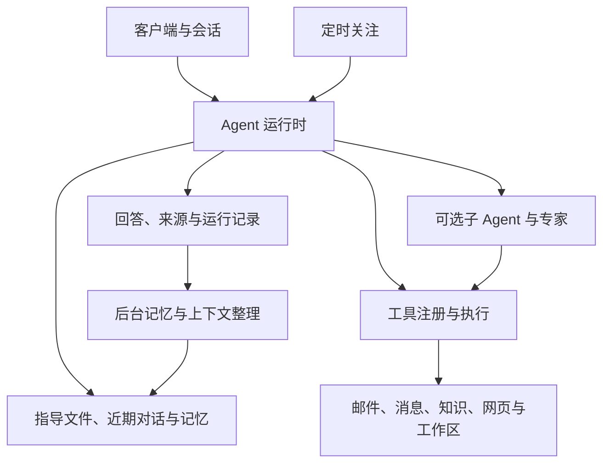

# 系统说明

本页说明当前后端组成及协作方式，不包含实施计划或测试过程记录。
具体请求、状态与控制接口以 [API 说明](api_contract.md) 为准。

## 各部分如何协作

客户端可以是命令行、独立桌面前端或自行接入的应用。
后端以 FastAPI 提供普通请求和 SSE 流，SQLite 保存会话、运行及各领域数据。
不同会话显式传递身份，没有隐式的全局“当前会话”。

事项的 visibility 与管理用途、责任方、日期相互独立。默认用户投影只显示 user，
完整授权同步保留 internal；管理扩展与执行关系由专用领域服务维护。
绑定目标引用 Matter 作为业务事实，自主提案在最终消息、事件水位和运行终态的同一事务内发布。

会话类型区分 ordinary 和可选的 manager。管理会话复用普通消息、运行、SSE 和检查点，
确定性管理服务保存 controller、默认入口、长期目标、事件收件箱与交付索引，不进行模型调用。
主管可通过 delegate_work 创建独立 manager 类型的事务线子 agent，保存归属、目标、冻结工具／路径与来源 envelope。
子 agent 是独立持久会话，初始派发、任务返回和主管补充指令唤醒它的新一轮，不依赖主管旧 run 存活。
子 agent 可执行自己的工作，或创建与介入自己名下的多个 ordinary 执行会话；首版不递归创建下级主管。
结果先由所属子 agent 审阅，report_delegate 在最终发布同一事务提交，再进入主管 inbox 唤醒新轮并生成本地消息。
失败、等待用户与未报告结果也保留稳定事件；执行终态不被推断为业务完成。

运行创建时冻结通用 session policy，统一控制模型默认值、工作区回退、工具和派发能力，
恢复和替换不会意外回到普通会话的完整能力。可选管理工具包创建独立 ordinary root，
命令指纹、会话关联、运行与派发 outbox 在 SQLite 同事务提交；重复命令读取原回执。
排队工作在受理时冻结独立 root、来源和额度，再由确定性就绪调度事务释放到通用 dispatcher；
期间不使用主管旧运行身份授权新建任务。工作区预留与公平水位持久保存，只读策略通过实际工具白名单限制。
显式 watch 订阅只消费现有已发布简报，按授权版本及稳定引用进入 inbox，不隐藏模型调用或扩大来源范围。
本地交付策略把捕获和提醒分开，静音／稍后保留未交付事件；发布同时复验交付策略与来源版本。
通用 session admission 为同一真实会话保留一个未终态主运行位置，child DAG 仍由原调度器处理。
通用输入 envelope 保存来源并以稳定消息 ID 去重，非用户输入不提取用户偏好。
通用 execution dispatcher 按租约动态启动独立执行线程，无固定管理 worker 池，执行已登记的 LangGraph 任务，续租并通过既有节点守卫阻止失租后的后续操作，
有检查点才恢复中断运行，不重建未知副作用任务。该切片支持单后端进程。
管理协调器捕获任务终态与到期 timer，以有界 ID 唤醒并冻结事件、目标版本和模型设置，
复用 dispatcher 执行原管理 run。controller 暂停时仍捕获事件。
自主轮最终提交在同一 SQLite 事务核对租约、controller／目标版本与取消状态，
发布回答、上下文、目标提案、事件消费水位、run 终态及稳定本地 delivery 引用。
业务提交后 checkpoint 尚未完成的恢复优先读取已提交 result artifact，避免重放工具。
独立任务继承持久额度和因果范围；自动设置的下一次 timer 也延续因果限制。
外部推送与用户输入自动抢占尚未实现。

## Agent 与工具

Agent 根据目标选择工具包，再按需展开具体工具，循环进行决策、执行和观察。
一个执行步骤调用一个工具或进入回答阶段；最终用户回答与内部控制动作分开生成。
工具输入、输出、只读声明和安全审查由执行器处理，领域服务不隐藏模型调用。
Agent 的每次工具调用都经过配置的逐调用审查，包括只读工具；`skip` 也会记录决定。工作区外
文件目标和 Bash 工作目录只获得当前调用的精确路径批准，子 Agent 的冻结路径范围仍是上限。
Bash 命令参数不受 OS 文件沙箱约束。

可选多 Agent 调度将独立子问题放进任务计划，冻结各自上下文、工具范围和预算。
子任务结果回到父任务后再进行合同及工具记录检查；失败可以反馈并修订计划。
邮件专家执行只读批处理，外部代码专家是单独启用的接入。

## 信息如何进入上下文

- 会话提供近期问答和已发布摘要，完整历史仍保存在本地。
- 指导文件按全局及项目路径加载，变更后重建索引和摘要。
- 长期记忆按全局或项目范围选择有效内容，派生记忆不修改用户指导文件。
- 知识检索、邮件、消息和网页提供选取的来源片段，而非整个数据源。
- 长工具结果保存为本地记录，模型先看到预览，再使用相应工具继续读取。

摘要、预览、搜索结果和阅读覆盖描述不同含义；进入模型输入不等于模型正确理解。
工具资料作为来源内容，不能替代用户要求或提升操作许可。
外部内容 gate 使用有界的中英文启发式检测常见指令式文本；扫描不完整会标记为未知，并保留
原始内容及来源信息。它不封禁来源或工具，也不保证识别所有恶意文本。

## 检索与缓存

本地知识支持 FTS 关键词和可选 FastEmbed / sqlite-vec 语义通道，
可通过多个查询并行召回后融合、统一重排序并选取结果。
消息使用实时本地关键词来源，现有消息并不自动参加向量召回。

普通工具缓存与网页快照分工不同：`observation` 回读当前运行的工具原始结果，
网页工具管理会话范围内的搜索记录和正文快照，支持跨轮续读、定位及显式刷新。
旧快照的时间和刷新失败都要保留，不能把本地回读当成新一次联网。

## 后台工作

记忆提取、上下文压缩和消息分析使用持久作业、租约、检查点与重试。
发布前复核来源许可、版本和水位，避免旧 worker 覆盖新结果。
前台与后台共享模型并发控制；消息分析与记忆／自动压缩独立计量。
记忆／自动压缩默认不设常规 token 配额，异常累计消耗触发持久化熔断，
阻止后续调用并取消同池在途请求。后台等待配额或熔断时不自动重置账本。

记忆入库前通过作用域内分页候选发现进行等价／更新判断；独立维护作业再整理
多条重复或互补记录。模型只提出方案，领域服务以同范围／类型／期限、来源、
多条版本 CAS 和作业租约原子提交，保留历史及撤销记录。去抖和周期扫描弥补
前台操作／提取与入队之间的空隙；处理中新增的版本不能被标成已完成。

定时关注将定义和每次执行分开保存，按照时区唤醒，为简报创建新会话。
任务只能读取已授权的数据源；暂停、取消和重新授权会影响后续执行。

## 源码组织

| 目录 | 职责 |
| --- | --- |
| `app/api/` | HTTP、SSE 与请求校验 |
| `app/core/` | Agent、模型连接、会话、上下文和通用执行控制 |
| `app/domains/` | 邮件、知识、消息、记忆、事项等确定性业务 |
| `app/tool_packages/` | Agent 可调用的工具及描述 |
| `app/integrations/` | 模型之外的外部服务接入 |
| `app/platform/` | Windows / Linux 路径、文件和进程适配 |
| `tests/`、`evals/` | 回归测试及可复用评测数据与程序 |
| `scripts/` | 启动、维护、评测和部署工具 |

仓库的 `AGENTS.md` 保留简短开发规则。当前工作区的工程资料单独管理，
不作为发布包的一部分，也不是客户端运行所必需。
